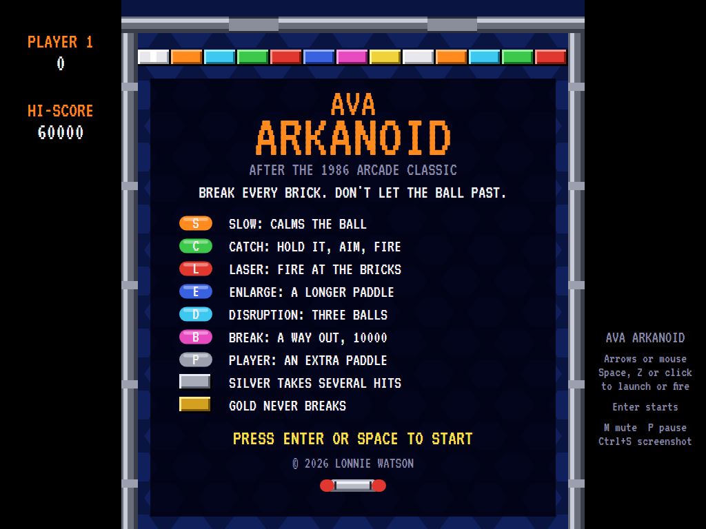
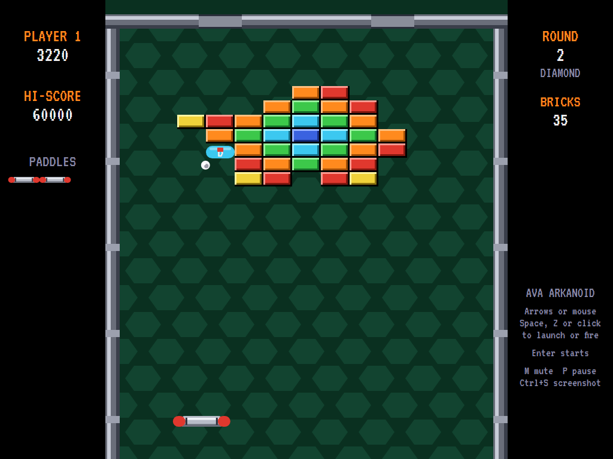
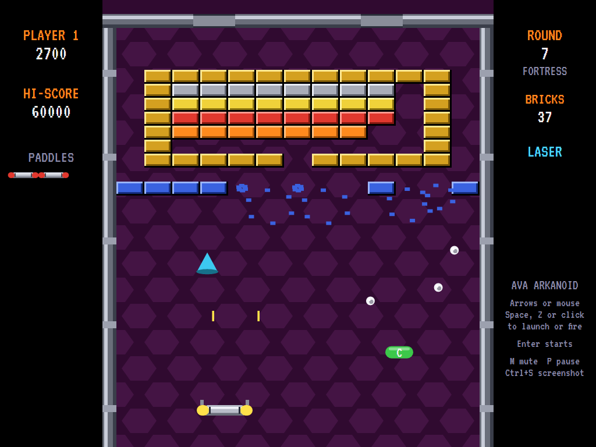
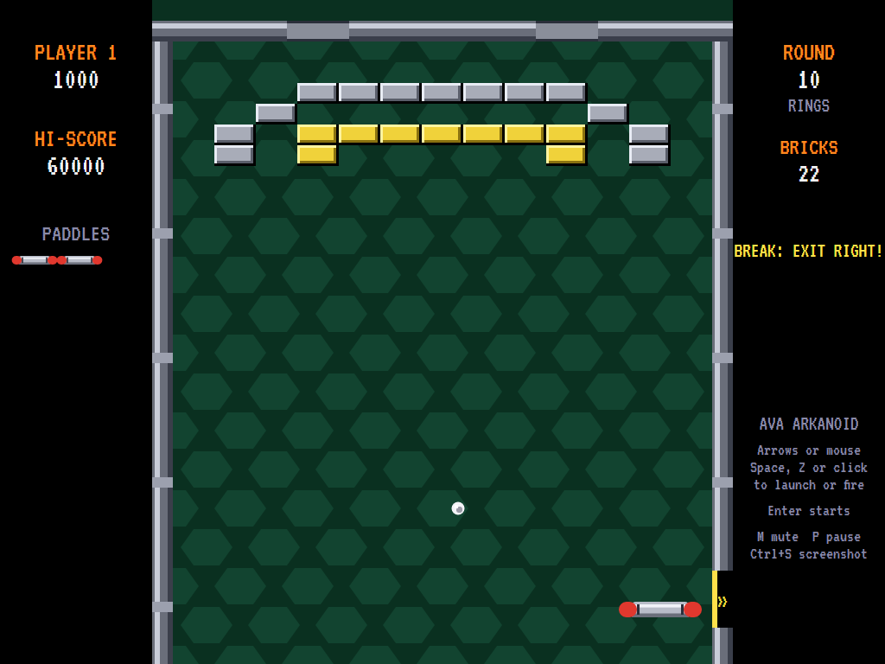
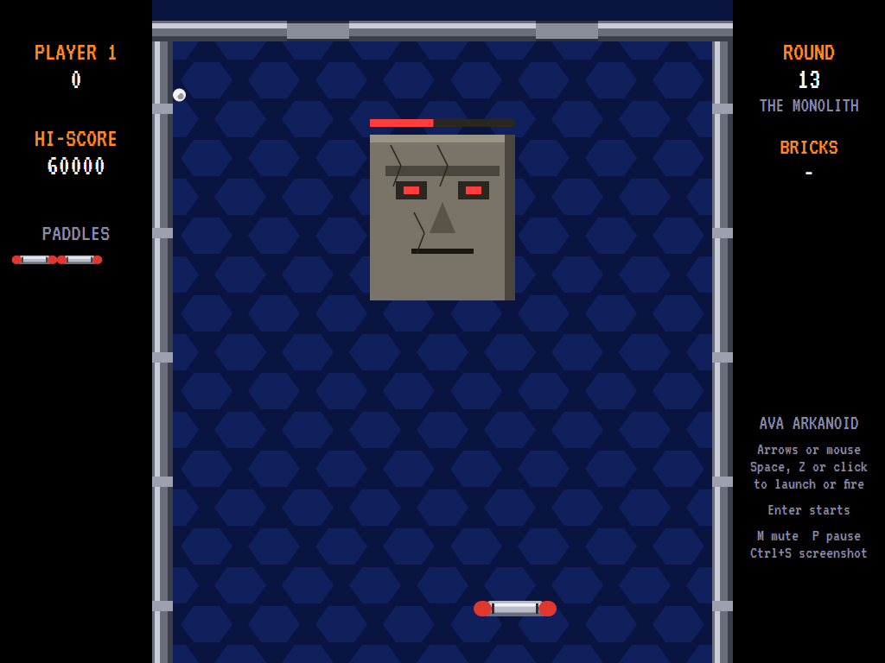
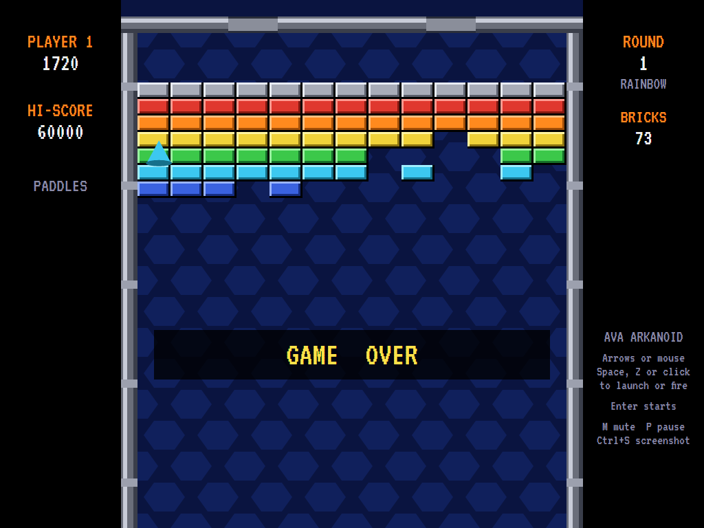

# AVAArkanoid

[](https://github.com/Harlock123/AVAArkanoid/actions/workflows/build.yml)

A brick-breaking game in the style of Taito's 1986 arcade game **Arkanoid**, built with .NET 10 and
Avalonia UI. Steer the paddle along the bottom, keep the ball in play, and break every brick. Catch the
capsules that fall for lasers, three balls, a longer paddle and more, and fight your way through
twelve rounds to the Monolith at the end.

## Features

- **Twelve rounds** of the game's own design (none is copied from the arcade's), from *Rainbow* and
  *Diamond* to *Fortress*, *Rings* and *Vault*, then **the Monolith**: a great stone face that takes
  sixteen hits and spits fire at the paddle. Beat it and it all starts again, faster.
- **Ball physics**: the ball comes off the paddle at an angle that depends on where it lands, straight
  up from the middle and sharper towards the ends. Bricks, walls and the paddle turn it back cleanly,
  in small steps so it never passes through anything. It speeds up as the round goes on and when it
  hits the top, and it never settles into a flat back-and-forth.
- **Bricks**: eight colours worth 50 to 120. **Silver** takes several hits and is worth more each
  round. **Gold** never breaks.
- **Capsules**: broken bricks now and then let one fall. Catch it with the paddle for 1,000 and its
  power:
  - **S**low calms the ball.
  - **C**atch holds the ball on the paddle until you fire it off.
  - **L**aser fires twin beams at the bricks.
  - **E**nlarge makes the paddle longer.
  - **D**isruption splits the ball into three.
  - **B**reak opens a way out in the side wall: go through it for 10,000 and the next round.
  - **P**layer is an extra paddle.
- **Drifters** come out of the hatches in the top and wander down. The ball, the lasers or the paddle
  break them for 100.
- **Mouse or keyboard**: move the mouse and the paddle follows it; click to launch or fire. Or use
  the arrow keys and Space, or a gamepad.
- **Sound**: the boops, clinks and clangs of the ball, the lasers, the capsules, the Monolith, an
  original title tune and fanfares, all mixed by OpenAL.
- **Attract mode**: leave the title alone for 15 seconds and a computer player plays a demonstration.
  It works out where each ball will come down off the walls, meets it a little off-centre to vary the
  angle, collects capsules when there's time, and dodges the Monolith's fire. It clears every round
  bar the Vault without dropping a ball, and beats the Monolith about half the time.
- **Three paddles**, a bonus paddle at 20,000 and every 60,000 after, and a **top-ten high-score
  table** with arcade-style initials entry. The table records the round you reached.
- **Any window size**: the screen scales to fit, letterboxed. **Ctrl+S** saves a screenshot.
- **One self-contained executable** per platform: Windows, macOS and Linux on Intel/AMD and ARM.

## Screenshots

| Title screen | A round under way | Lasers and three balls |
|:------------:|:-----------------:|:----------------------:|
|  |  |  |
| What the capsules do. | *Diamond*, half broken, a Disruption capsule falling. | *Fortress*: lasers, three balls, a drifter and a capsule. |

| The way out | The Monolith | Game over |
|:-----------:|:------------:|:---------:|
|  |  |  |
| A Break capsule: the gap in the right-hand wall. | The last round, cracked and burning. | Out of paddles. |

The screenshots are made by the tests, which play the game in a real (headless) window; see
[Tests](#tests).

## Download and run

Ready-to-run builds for Windows, macOS and Linux, on both Intel/AMD and ARM, are on the
[Releases page](https://github.com/Harlock123/AVAArkanoid/releases/tag/latest). **Latest build** is
rebuilt on every push to `main`. Each download is one self-contained executable: no .NET install is
needed.

| Platform | Archive |
|---|---|
| Windows | `AVAArkanoid-win-x64.zip`, `AVAArkanoid-win-x86.zip`, `AVAArkanoid-win-arm64.zip` |
| macOS | `AVAArkanoid-osx-arm64.tar.gz` (Apple silicon), `AVAArkanoid-osx-x64.tar.gz` (Intel) |
| Linux | `AVAArkanoid-linux-x64.tar.gz`, `AVAArkanoid-linux-arm64.tar.gz`, `AVAArkanoid-linux-arm.tar.gz` |

```bash
tar -xzf AVAArkanoid-linux-x64.tar.gz     # or linux-arm64, linux-arm, osx-arm64, osx-x64
./AVAArkanoid
```

On Windows, unzip and run `AVAArkanoid.exe`. On macOS, if Gatekeeper refuses to open it, run
`xattr -d com.apple.quarantine AVAArkanoid` once. Run with `--no-audio` for silence.

**Sound** comes through OpenAL Soft, built in for every platform. In a virtual machine the game
detects it and uses a larger audio buffer, so the sound doesn't break up.

**Gamepads** use SDL2, which is bundled for Windows, macOS and Intel/AMD Linux. ARM Linux builds need it
installed; without it the keyboard and mouse still work:

```bash
sudo apt install libsdl2-dev            # Debian / Ubuntu / Raspberry Pi OS
sudo pacman -S --needed sdl2-compat     # Arch / Omarchy
```

## Controls

| Input | Action |
|-------|--------|
| **Mouse** | The paddle follows it |
| **Arrow keys** / **A**, **D** | Move the paddle |
| **Click** / **Space** / **Z** / **Up** | Launch the ball, let go of a caught ball, fire the lasers |
| **Enter** / **Space** | Start a game |
| **P** / **Esc** | Pause (Esc again to quit) |
| **M** | Mute |
| **Ctrl+S** / **Cmd+S** | Save a screenshot to the Pictures folder |

**Gamepad**: left stick or D-pad to move, **A** or **B** to launch and fire; **Start** or **A**
starts, **Start** pauses, **Back** (while paused) quits.

**Entering initials**: type letters, or dial with **Up**/**Down** and accept with **Space**; **Left** /
**Backspace** go back; **Enter** finishes.

## Scoring

| What | Points |
|---|---:|
| White, orange, cyan, green, red, blue, pink, yellow brick | 50, 60, 70, 80, 90, 100, 110, 120 |
| Silver brick | 50 × the round |
| A capsule caught | 1,000 |
| A drifter | 100 |
| Out through the Break | 10,000 |
| The Monolith | 30,000 |

## Tests

```bash
dotnet test AVAArkanoid.slnx
```

The engine has no UI and runs in fixed 60 Hz steps, so it plays the same at any frame rate, and a seed
always plays the same game. The tests check:

- the rounds; launching (by fire and by itself); the paddle's bounds and the mouse;
- the angle off the paddle, the walls, the top speeding the ball up, and never too flat a path;
- bricks, silver and gold; losing a ball; clearing a round;
- every capsule: catching and missing, lasers, catch, disruption, slow, the Break way out, an extra
  paddle;
- drifters coming out and breaking; the Monolith's hits, fire and fall, and going round again;
- bonus paddles, the title tune, the demonstration's sound, pausing, and every sound.

A computer player (the attract-mode one) plays whole games in them and must clear the first round.

The screenshot tests draw the real screen in a headless window. To refresh the README's pictures:

```bash
ARKANOID_SHOTS=$PWD/Images dotnet test tests/AVAArkanoid.Tests --filter ScreenshotTests
```

## Building

```bash
dotnet build AVAArkanoid.slnx
dotnet run --project src/AVAArkanoid
```

Needs the .NET 10 SDK. The sounds are made by `tools/make_sounds.py` (standard-library Python):
`python3 tools/make_sounds.py` rewrites `src/AVAArkanoid/Sounds`.

## Project structure

```
AVAArkanoid/
├── AVAArkanoid.slnx
├── src/AVAArkanoid/
│   ├── Engine/
│   │   ├── GameEngine.cs        # States, scoring and bonus paddles
│   │   ├── GameEngine.Play.cs   # The paddle, the ball and what it hits, capsules and powers, lasers,
│   │   │                        # drifters, the Monolith, and the rounds
│   │   ├── Entities.cs          # Paddle, balls, bricks, capsules, beams, drifters, the Monolith
│   │   ├── AttractPilot.cs      # The computer player for the demonstration (and the tests)
│   │   ├── HighScoreTable.cs, InitialsEntry.cs
│   │   ├── InputHandler.cs, ControllerManager.cs  # Keys, the mouse and an SDL2 gamepad
│   │   └── SoundManager.cs      # Effects and tunes through OpenAL
│   ├── Audio/                   # The OpenAL engine (from the author's AVABand)
│   ├── Models/Field.cs          # The field's measurements, the bricks, and the thirteen rounds
│   ├── Views/                   # The screen: walls and backgrounds, bricks, paddle, capsules, the
│   │                            # Monolith, panels, title and tables
│   └── Sounds/                  # The synthesised effects and tunes
├── tests/AVAArkanoid.Tests/     # Gameplay and screenshot tests
├── tools/make_sounds.py
└── Images/                      # Screenshots
```

## About and licence

AVAArkanoid © 2026 Lonnie Watson, under the [MIT License](LICENSE).

*Arkanoid* © 1986 Taito; the name belongs to its current owner. AVAArkanoid is an independent,
unofficial game in its style. Its rounds, the Monolith, graphics, sounds, tunes and code are its own;
nothing is taken from the arcade machine's program, rounds, graphics or sound. It is not affiliated
with or endorsed by any rights holder.

Bundled components keep their own licences: the VT323 font (SIL Open Font License 1.1, by Peter Hull;
`src/AVAArkanoid/Assets/Fonts/VT323-OFL.txt`), OpenAL Soft (LGPL-2.0-or-later; loaded as a separate
library; `src/AVAArkanoid/Audio/native/COPYING-openal-soft.txt`), and the MIT-licensed Avalonia,
Silk.NET, NVorbis, NLayer and SDL2-CS (with SDL2 under the zlib licence).
